 

**tl;dr** → SFU CS grad (AI concentration). I build AI you can audit, automation that eats busywork, and apps that are actually fun to use. I measure before I flex.

☝️ tap the race to run it live &nbsp;·&nbsp; <a href="https://github.com/NDNathanRocks/DualSight">peek the source</a>

  
  

### 🎮 side quests (tap to open)

<b>🌊 WaveLit</b> · live wallpapers that take a nap when you game

 

Wallpapers, music visualizers and widgets that stretch across every monitor and drop to **~0% GPU** when you can't see them (games, fullscreen, lock screen). The built-in **AI Studio** turns a text prompt into a shader, then checks it for safety and speed on *your* GPU before it ever runs.

`C#` `.NET 10` `WPF` `WebView2` `GitHub Actions` · open source (GPL v3) · [**repo →**](https://github.com/NDNathanRocks/WaveLit)

<b>🛋️ Armrest</b> · your phone is the TV remote now

 

Scan a QR code once (no accounts) and say *"play lofi on YouTube"*, drag the volume, or use your phone as a touchpad. A Windows agent tries fast local rules first, calls an AI helper only when it needs to, and checks that every action actually worked. A serverless AWS relay connects phone and PC, with a home-network fallback.

`Python` `React` `AWS Lambda` `API Gateway WebSocket` `DynamoDB` · [**repo →**](https://github.com/NDNathanRocks/Armrest)

<b>📼 the archives</b> · older builds, one hackathon trophy

 

- [**Clarity**](https://github.com/NDNathanRocks/Clarity-Your-AI-Time-Companion) · an AI time-awareness assistant that learns from your past estimates. `React Native` `Django` `Claude API`
- [**BinIt!**](https://github.com/NDNathanRocks/BinIt) · an AI trash sorter. 🏆 WiCS Best Project at SystemHacks 2023. `Flask` `React` `ResNet152`

<b>📟 recruiter mode</b> · the plain-text version

 

- **Fraser Health Authority** (2024 → now): built ETL pipelines, dashboards and Power BI analytics. Cut a weekly 30+ hour manual process to under 5 minutes and sped up a UKG WFM migration by 60%.
- **DualSight**: hybrid RAG (BM25 + dense, RRF), LangGraph, semantic cache with a figure guard, ~350 automated tests in CI, deployed on Vercel + Render.
- **Education**: BSc Computing Science, AI concentration, Simon Fraser University (2025).
- **Open to**: full-stack, AI/ML engineering and data roles in Canada. English + Hindi.

### 🃏 two truths & a lie

> **1.** I go open water diving 🤿 &nbsp; **2.** I speak English and Hindi 🗣️ &nbsp; **3.** I've never shipped a bug 🐛

👀 <b>reveal</b>

 

**#3, obviously.** DualSight's own live accuracy test caught a schema bug that had the engineered side right only 1 time in 4. Found it, fixed it, wrote it up in the README. That's the whole vibe: test it, then say it.

 

